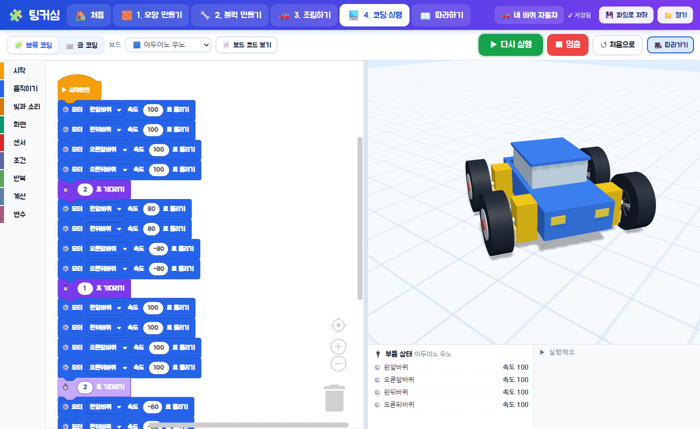

# 🧩 팅커심 (webTinkerSim)

3D 모양을 만들고, 모터·LED·센서를 붙이고, 코딩으로 움직여 보는 **초등학생용 웹 피지컬 컴퓨팅 시뮬레이터**예요.
웹 브라우저만 있으면 되고, 설치하거나 따로 실행할 프로그램이 없어요.

👉 **바로 해 보기: https://samcho93.github.io/webTinkerSim/**

## 이렇게 만들어요

| 단계 | 화면 | 하는 일 |
|---|---|---|
| ① | 🧱 모양 만들기 | 팅커캐드 기본 모양 19가지(상자·원기둥·공·지붕·둥근 지붕·글자·쐐기·다각형·포물면·20면체·상자/원기둥 구멍 …)로 구조물을 만들어요. 여러 개 고르기, 복사·붙여넣기·잘라내기·복제, 🧩 합치기(그룹)/풀기, 📎 붙이기/떼기, 정렬, 뒤집기, 되돌리기를 쓸 수 있어요. 팅커캐드 STL 파일도 불러오고 내보낼 수 있어요. |
| ② | 🔧 블럭 만들기 | 모양 + 부품(DC 모터, 서보 모터, 밀기 모터, LED, 버저, LCD, 버튼, 거리 센서, 라인 센서)을 묶어 "블럭"을 만들어요. 움직임 종류(빙글빙글 돌기 / 팔처럼 꺾기 / 돌림판처럼 돌기 / 밀고 당기기)와 "다른 블럭을 붙일 수 있는지"를 골라요. |
| ③ | 🚗 조립하기 | 바탕 모양을 골라 로봇을 만들고, 블럭을 마우스로 끌어다 면에 착 붙여요. 블럭 위에 블럭을 이어 붙일 수 있고, 로봇을 여러 개 만들어 함께 움직일 수 있어요. |
| ④ | 💻 코딩·실행 | 블록 코딩(또는 한글 자바스크립트 글 코딩)으로 명령을 주고 ▶ 실행하면 오른쪽 3D 화면에서 움직여요. |

## 자동으로 해 주는 것들

- **크기·축 맞추기**: 블럭을 만들면 모양이 모터 축에 자동으로 맞춰지고, 부품 크기도 모양에 맞게 조절돼요. 조립할 때 너무 크거나 작은 블럭은 바탕에 맞게 자동으로 크기를 바꿔요.
- **붙이는 방향**: 놓는 면의 방향을 읽어 블럭이 바깥쪽을 향하도록 붙어요(격자에 맞춰 착!).
- **움직임 적용**: DC 모터는 계속 회전, 서보는 0~180도, 밀기 모터는 0~100% 위치로 움직여요.
- **굴러가는 로봇**: 바닥에 닿은 바퀴를 자동으로 찾아서, 바퀴가 돌면 로봇 전체가 굴러가요. 왼쪽/오른쪽 바퀴 방향도 자동으로 맞춰서 속도를 + 로 주면 앞으로 가요.
- **부딪힘·센서**: 벽과 다른 로봇에 부딪히면 멈추고, 거리 센서는 실제로 앞을 재고, 라인 센서는 바닥의 검은 선을 찾아요.

## 지원하는 보드와 언어

| 보드 | 만들어 주는 코드 |
|---|---|
| 아두이노 우노 | 아두이노 C/C++ (.ino) |
| ESP32 | 아두이노 C/C++ (ESP32Servo) |
| 마이크로비트 | 마이크로파이썬 (python.microbit.org) |
| 라즈베리파이 피코 | 마이크로파이썬 |

- 부품마다 보드 핀을 자동으로 정하고 **연결표**를 보여줘요. (실제 보드와 직접 연결하는 기능은 없어요. 만든 코드를 복사하거나 내려받아 써요.)
- 코딩 언어: 블록 코딩, 글 코딩(한글 함수 이름을 쓰는 자바스크립트), 아두이노 C/C++, 마이크로파이썬.

## 합치기와 붙이기

| | 🧩 합치기 (그룹) | 📎 붙이기 |
|---|---|---|
| 모습 | 녹아서 **하나의 모양**이 돼요 (색 하나, 안쪽 경계 없음) | 조각들의 **색과 모양이 그대로** 있어요 |
| 구멍 | 함께 합친 구멍 모양이 뚫려요 | 구멍 조각은 구멍 조각으로 남아요 |
| 고치기 | 🔓 풀기로 다시 나눠서 고쳐요 | 두 번 클릭하면 붙인 채로 안쪽 조각을 하나씩 고쳐요 |
| 단축키 | Ctrl+G / Ctrl+Shift+G | Ctrl+B / Ctrl+Shift+B |

그 밖의 단축키: Ctrl+C/V/X/D (복사/붙여넣기/잘라내기/복제), Ctrl+Z/Y, Ctrl+A, Delete, 화살표(옮기기, Ctrl+↑↓ 높이), D(바닥에 내리기), H(구멍), S(단단한 모양), W/E/R(옮기기/돌리기/크기)

## 예제 프로젝트 (13개)

🚗 네 바퀴 자동차 · 🦾 3관절 로봇팔 · 🚦 신호등 · 🌀 버튼 선풍기 · 🚧 주차 차단기(로봇 2대) · 🤖 장애물 피하는 자동차 · 🎠 회전목마 · 🛗 엘리베이터 · 📟 숫자 세는 전광판 · 👋 인사하는 로봇 · 〰️ 라인트레이서 · 🎹 멜로디 상자 · 🚁 헬리콥터

## 따라하기

앱 안의 **📖 따라하기**에 그림이 들어간 8개 단원(둘러보기 → 모양 → 블럭 → 조립 → 코딩 → 로봇팔 → 센서 → 보드 코드)이 있어요.

## 프로젝트 파일

작품은 브라우저 안(IndexedDB)에 자동 저장되고, `💾 파일로 저장`으로 `.tsim` 파일(JSON)을 내려받아 나눌 수 있어요.
파일 안에는 모양들(STL 포함), 블럭, 로봇 조립 정보, 코드, 보드 종류, 무대가 모두 들어 있어요.

## 개발 정보

- 빌드 과정 없는 정적 웹앱(ES 모듈). 라이브러리는 CDN에서 불러와요: three.js 0.160, three-bvh-csg(구멍 뚫기), Blockly 10.
- 로컬에서 보기: 아무 정적 서버로 폴더를 열면 돼요. 예) `python -m http.server`
- `js/` 구성

| 파일 | 역할 |
|---|---|
| `main.js` | 앱 시작, 화면 전환, 저장 |
| `shapes.js`, `stl.js`, `library.js` | 모양(나무 구조: 기본 모양·합치기·붙이기), 구멍/합치기(CSG), STL, 미리 만든 모양 |
| `components.js` | 부품 3D 모델과 블럭(모양+부품) 모델 |
| `world.js` | 조립 무대, 바퀴 굴러가기, 부딪힘, 센서 계산 |
| `codegen.js`, `runner.js` | 블록 정의, 코드 만들기(JS/아두이노/마이크로파이썬), 실행 |
| `boards.js` | 보드 정보와 핀 자동 배정 |
| `maker.js`, `blockmaker.js`, `assemble.js`, `coding.js`, `home.js`, `tutorial.js` | 각 화면 |
| `examples.js` | 예제 프로젝트 |

- 따라하기 그림 다시 찍기(개발용): 서버를 켠 뒤 `node tools/shoot.mjs http://localhost:8000`
